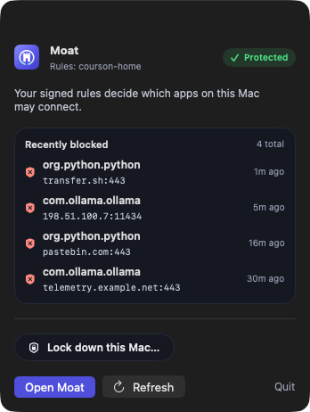
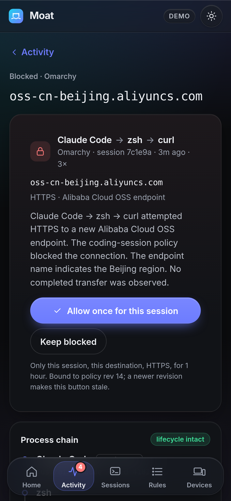
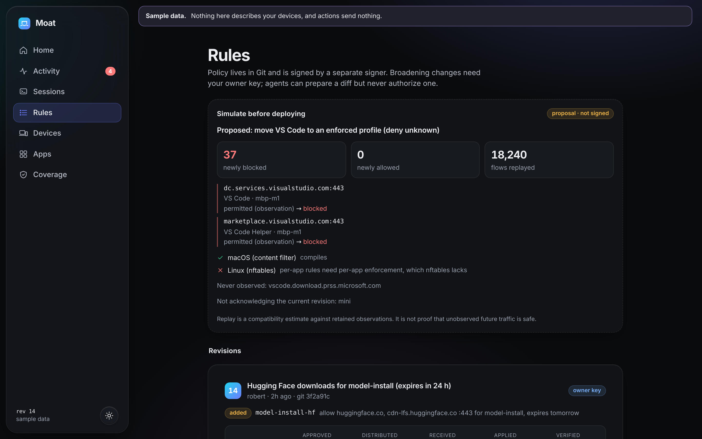
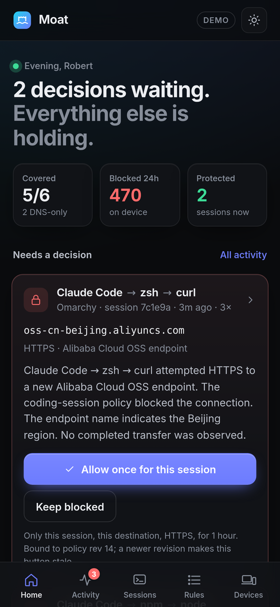

<div align="center">

# Moat

**Understand and control what software can send from your devices,<br>with stronger boundaries for the workloads you choose to protect.**

An open, self-hosted outbound firewall for people whose software increasingly acts on their behalf: coding agents,
MCP servers, package installers, local models, generated programs. One signed policy across your Macs and Linux
machines, enforced locally on each device, coordinated by an optional controller you run yourself.

[Status](docs/STATUS.md) · [Protection contract](docs/protection-contract.md) · [Policy semantics](docs/policy-semantics.md) · [Threat model](docs/threat-model.md)

</div>

<p align="center">
  
</p>
<p align="center"><sub>The macOS app on macOS 26, captured from the real app window on the CI runner in demo mode (no signed install).</sub></p>

> **Read this first.** Moat is an **experimental build** and has not met its first release gate. Known open
> defects include temporary grants that lose device and process scope, a launcher path a contained Linux workload can
> use to request a looser session, and activation state that is not durably journaled; they are listed, with the work
> package that closes each one, in the [claim ledger](docs/STATUS.md). The Linux protected-session boundary passes its
> tests on a CI runner kernel but has not been proven through the installed service; the macOS content filter has
> never run as a signed system extension. Nothing is marked *supported* until installed or real-workflow evidence
> exists. There is no fail-closed claim, no VPN-compatibility claim and no TLS interception; phones and the TV get
> **DNS-only** coverage, labeled as such.

## Three things, never blended

| | What it means | Where |
| --- | --- | --- |
| **Observed** | Moat sees a connection and records it. Nothing is blocked, and the UI says *permitted, not enforced*. | macOS, Linux |
| **Enforced** | Your signed policy decides; a deny happens at the OS hook before data passes. | macOS per-app (untested on device), Linux device/user-wide |
| **Protected session** | A boundary built **before the workload runs**, inherited by every child, escape-tested. Hostname rules for TCP are enforced by a per-session egress proxy (TLS SNI / HTTP CONNECT / Host, no TLS interception). | Linux `moat-launch` (cgroup v2 + nftables); proxy CI-tested, *untested* on Omarchy |

A launcher that only adds a label is an *instrumented* session, not a protected one, and Moat never calls it one.

## What it looks like

<table>
<tr>
<td width="58%"></td>
<td></td>
</tr>
<tr>
<td><sub><b>macOS Activity.</b> Blocked flows say <i>blocked before data was sent</i>; observed flows are never called allowed; bytes appear only when macOS reported them.</sub></td>
<td><sub><b>Menu bar extra.</b> Coverage at a glance, recent blocks, and Isolate this Mac behind a second explicit confirmation. Turning isolation off still needs the typed phrase in Recovery.</sub></td>
</tr>
<tr>
<td></td>
<td></td>
</tr>
<tr>
<td><sub><b>First-run onboarding.</b> Starts with what Moat can and cannot claim on this Mac, then walks through extension approval, the content filter and adding your signer key (you add it; the app only reads it).</sub></td>
<td><sub><b>Phone web UI.</b> "Allow once for this session" is bound to the incident, policy revision and session instance; stale approvals are rejected.</sub></td>
</tr>
<tr>
<td></td>
<td></td>
</tr>
<tr>
<td><sub><b>Rules.</b> Every revision shows its diff, who authorized it, per-device delivery state, and what each platform had to leave out.</sub></td>
<td><sub><b>Home.</b> Which devices are covered, what is blocked, what needs a decision.</sub></td>
</tr>
</table>

**About these images.** The `macos-*.png` files are captured from the real Moat app window (`screencapture -l`) on
GitHub's `macos-26` runner, built unsigned with Xcode 26 and launched with `--demo`, so the data comes from the demo
client backed by the real `ControlHandler`, not from a running content filter
([`macos/scripts/capture-screenshots.sh`](macos/scripts/capture-screenshots.sh)). The window height is limited by the
runner's small display. The phone and desktop images are the fleet web UI rendered in CI from its demo build. More in
[docs/screenshots](docs/screenshots).

## What's in this build

* **macOS app in Liquid Glass.** Rebuilt for macOS 26: glass sidebar and toolbar, glass controls and morphing
  status, with macOS 14/15 fallbacks and support for Reduce Transparency, Increase Contrast and Reduce Motion.
  Builds and is captured in CI; not yet checked by eye on a real Mac.
* **Menu bar extra.** Status, recent blocks and a confirmed isolate, without opening the window.
* **First-run onboarding.** Honest coverage labels first, then extension approval, the content filter and signer
  key. The approval steps need a signed build on a real Mac and have not run there yet.
* **Linux timed rollback.** `moatd apply --trial-secs N` installs a trial revision that reverts on its own unless you
  run `moatd recover confirm`; `recover rollback` reverts now. The replay mark is kept, the first revision cannot be a
  trial, and rollback never touches isolation. Proven in CI's netns suite; untested on Omarchy.
* **Session hostname proxy (Linux).** Inside a protected session, TCP hostname rules are enforced by a per-session
  loopback proxy that reads TLS SNI, HTTP CONNECT or Host, resolves the name itself and connects only to what it
  resolved; nftables fences the listener. No TLS interception. UDP stays IP-only and domain fronting is still
  possible. Advertised as `untested` until run on Omarchy.

See [docs/STATUS.md](docs/STATUS.md) for exactly what each of these has and has not been proven on.

## Architecture

```
  reviewed policy (Git) ──► policy authority ──► signed per-platform snapshots
          ▲                 (separate signer;            │
          │                  owner key to broaden)       ├──► Mac: content-filter system extension ──► existing network path
   private web UI ◄── controller (Mac mini) ◄── receipts, ├──► Linux: moatd (nftables + cgroup v2)  ──► existing network path
   (phone-first)      flow store, incidents,   events     └──► DNS: AdGuard Home / Pi-hole (phones, TV: DNS-only)
                      notifications
```

Traffic never flows through the controller. Endpoints enforce the last valid signed policy on their own, keep a
sequenced spool, and offer local recovery that works when the controller or the tailnet is down.

| Component | Path | Language |
| --- | --- | --- |
| Policy model, compiler, evaluator, signing, conformance | `core/moat-core`, `conformance/` | Rust |
| CLI: validate, compile, diff, simulate, sign, verify, explain | `core/moatctl` | Rust |
| C ABI for native apps | `core/moat-ffi` | Rust |
| Linux endpoint + protected launcher (`moatd`, `moat-launch`) | `linux/` | Rust |
| macOS app, content-filter system extension, MoatKit | `macos/` | Swift |
| Controller: enrollment, policy service, signer, flow store, incidents, notifier, DNS adapters, DK feed | `controller/` | TypeScript (Node 22) |
| Fleet web UI | `web/` | React + Vite |
| Recognizer and service packs (data only) | `packs/` | JSON |

## Quick start

**Policy tooling** (any OS with Rust):

```sh
cargo build --release -p moatctl
./target/release/moatctl validate conformance/policies/home.toml
./target/release/moatctl compile conformance/policies/home.toml --adapter macos --revision 1 -o snap.json
./target/release/moatctl keygen --out ~/moat-signer.key        # keep it out of agent workspaces
./target/release/moatctl sign snap.json --key ~/moat-signer.key -o signed.json
./target/release/moatctl conformance conformance
```

**Linux / Omarchy**: see [docs/platforms/linux.md](docs/platforms/linux.md).

```sh
cd linux/packaging/arch && makepkg -si
sudo moatd trust ~/moat-signer.key.pub && sudo systemctl enable --now moatd
moat-launch --profile coding-session -- claude    # PTY proxy keeps your TUI interactive
```

**macOS**: see [docs/platforms/macos.md](docs/platforms/macos.md). Contributors can build unsigned; a runnable
system extension needs a Developer ID build (`macos/scripts/release.sh`). Run the app with `--demo` to explore.

**Controller + web UI** (on the mini):

```sh
npm ci && cargo build -p moatctl
node controller/src/main.ts init ~/moat-data     # prints the next steps (owner key, signer service, serve)
npm run dev -w web                               # or the static demo: npm run build:demo -w web
```

## Design rules (and where they do not hold yet)

These are the rules the code is built around. Where a rule is not yet true, the [claim ledger](docs/STATUS.md)
names the defect and the regression test that will close it.

* **No silent weakening.** A rule needing a capability the device lacks is rejected, or (allow rules only) left out
  *with a report*. Profiles are not yet capability-checked (`D-PROFILE-CAPABILITY`).
* **No scripts in policy.** Strict, versioned data; unknown fields rejected.
* **Signed, platform-matched, replay-protected snapshots.** Trust is owner configuration; nothing promotes it.
* **Agents cannot authorize themselves.** Broadening needs the owner key; agents can only propose a diff and assert
  intent. The broadening classifier still misses some changes (`D-DIFF-*`), and generated grants lose scope
  (`D-GRANT-SCOPE-LOSS`).
* **Isolation is sticky.** No heartbeat loss, restart, new policy or canary rollback reopens it.
* **Gaps are visible.** Sequence numbers, restart and gap records; enforcement never waits on logging.
* **No invented measurements.** No "0 bytes" without a measurement, never an intended upload size.

## Documentation

[Protection contract](docs/protection-contract.md) ·
[Failure behavior](docs/failure-behavior.md) ·
[Policy semantics](docs/policy-semantics.md) ·
[Threat model](docs/threat-model.md) ·
[Privacy](docs/privacy.md) ·
[VPN test matrix](docs/vpn-test-matrix.md) ·
[Compatibility suite](docs/compatibility-suite.md) ·
[Feasibility checklist](docs/feasibility-checklist.md) ·
[Licensing](docs/licensing.md) ·
[Linux](docs/platforms/linux.md) ·
[macOS](docs/platforms/macos.md) ·
[OpenSnitch adapter feasibility](docs/platforms/opensnitch-adapter-feasibility.md) ·
[**Status**](docs/STATUS.md)

## License

Apache-2.0. No code from GPL projects (LuLu, OpenSnitch) is included; see [docs/licensing.md](docs/licensing.md).
