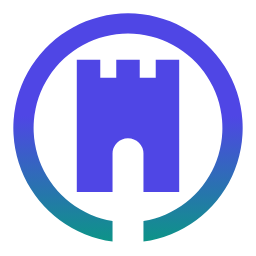

# Moat design system

Moat's UI on the web (phone PWA and desktop dashboard) and on macOS shares one calm "bento" system: a cool-grey
canvas, opaque cards with hairline borders and very soft shadows, a periwinkle/indigo accent with teal and amber as
secondary tones, crisp Inter type and tabular figures. Light mode is first-class; dark mode is a separately tuned
palette, not an inversion.

Sources of truth:

| What | Where |
|---|---|
| Colour, type, radius and spacing tokens | [`brand/design-tokens.json`](../brand/design-tokens.json) |
| Web CSS variables (generated) | [`web/src/tokens.css`](../web/src/tokens.css) |
| macOS colour sets, AppIcon, menu bar template (generated) | [`macos/Moat/App/Assets.xcassets`](../macos/Moat/App/Assets.xcassets) |
| macOS palette in code (kept in sync, checked) | [`macos/MoatKit/Sources/MoatUI/Theme.swift`](../macos/MoatKit/Sources/MoatUI/Theme.swift) |
| The mark and icons | [`brand/`](../brand) |

`node web/scripts/brand.mjs` regenerates everything from the SVGs and the token file (`--tokens` skips the rasters
and needs no browser). `web/src/tokens.test.ts` fails when `tokens.css` or `Theme.swift` drift from the token file,
and checks that every text tone meets WCAG AA on its card surface in both appearances.

## The mark

A keep (three merlons, walls, a round-topped gate) inside a moat ring. The ring is open only below the gate: the one
supervised way out. That is what Moat is, an egress gate around your Digital Kingdom.

* Geometry: a 24-unit grid; ring outer radius 10.75, inner 8.85; the gap is exactly the gate's width (2.9). It stays
  legible at 16 px because it is two solid shapes with no hairlines.
* Variants: `moat-mark.svg` (one colour, `currentColor`), `moat-mark-light.svg` / `moat-mark-dark.svg` (accent keep,
  accent-to-teal ring), `moat-icon.svg` (rounded square: favicon, apple-touch, PWA), `moat-icon-maskable.svg`
  (full bleed, mark in the safe zone), `moat-app-icon-macos.svg` (macOS icon grid: 824 px body, 100 px margin).
* Menu bar: a template image (black + alpha, 18 pt) that macOS tints. When coverage needs attention the coverage
  symbol replaces the mark, so the status item never hides a problem behind the logo.
* Clear space: half the mark's width on every side. Do not rotate, outline, add effects or recolour the ring and keep
  separately outside the defined variants.

## Colour

| Token | Light | Dark | Use |
|---|---|---|---|
| `bg` | `#F3F4F8` | `#0C0E14` | canvas |
| `surface` / `-2` / `-3` | `#FFFFFF` / `#F7F8FB` / `#EDEFF5` | `#151821` / `#1A1E29` / `#222734` | cards, insets, tracks |
| `border` / `-strong` | `#E3E6EE` / `#CDD2DE` | `#252A37` / `#353B4B` | hairlines, inputs |
| `text` / `text-2` / `muted` | `#0F1222` / `#3A4055` / `#5D6478` | `#ECEEF5` / `#C3C8D6` / `#969DB0` | copy |
| `accent` | `#4F46E5` | `#A5A8FF` | links, selection, focus |
| `accent-strong` | `#4F46E5` | `#5B5BEA` | solid fills carrying white text (macOS prominent buttons, sidebar selection) |
| `accent-soft` | `#EEF0FF` | `#23264A` | selected rows, announcement banners |
| `chart-1` / `-2` / `-3` | `#8B8FF7` / `#5CC8B4` / `#F5B83D` | `#7C80F0` / `#3FBFA9` / `#E9A93A` | observed / allowed / heat |
| `green` `red` `amber` `blue` `violet` `teal` | AA on white | AA on `surface` | status text and chip tints |

Dark mode is tuned on its own: lighter, less saturated status tones, a periwinkle accent, near-zero shadows with a
1 px inner highlight, and the same hierarchy of surfaces.

### Status is never colour alone

Every status chip pairs an icon with its label (web `Badge`, macOS `Pill`): green ✓, red ✕, amber ⚠, blue ⓘ,
violet globe, and specific icons for coverage (lock for protected session, shield for enforced, eye for monitoring,
globe for DNS only, ⚠ degraded, wrench recovery required, undo rollback pending, ? unknown) and support
(✓ supported, ⚠ partial, clock "needs device proof", − not available). Neutral chips (counts, ids) carry text only.

## Type

Inter Variable (`cv11`, `ss01`, `ss03`) on the web; the system font (SF Pro) on macOS. Every figure uses tabular
numerals.

| Role | Size / weight |
|---|---|
| Display (page title) | 28–34 px / 700, tracking −0.028 em |
| Card title | 15 px / 650 |
| Body | 15 px / 450, line height 1.5 |
| Label / qualifier | 12.5 px / 560, muted |
| Chip | 12 px / 600 |
| KPI figure | 30 px / 700, tracking −0.03 em |

## Layout and components

* **Bento grid**: 12 columns from 1180 px, 6 from 720 px, one column on phones; 16 px gaps. Overview and Apps are
  bento grids; other screens keep a 960 px reading column with the same cards.
* **Card**: radius 14 (inner elements 10), 1 px border, soft shadow (light only), 18 px padding. A card title can
  carry a quiet qualifier line ("Endpoint rollups | last 24 hours").
* **KPI tile**: chip label with icon, big tabular figure, a sub line, and a tiny chart (sparkline or ring) when there
  is a real series behind it.
* **Charts**: bar strip (hourly allowed / observed / blocked), heat grid (verdict × 4-hour window, each row scaled to
  its own peak), honeycomb (blocked attempts per hour, periwinkle to amber, current hour outlined), progress rings
  (devices with current coverage; endpoint receipts for the latest revision), evidence-age bars (each device's last
  report against the 10-minute freshness limit), ranked list (apps by recorded flows), and on macOS a flow strip (one
  tick per recent flow record, coloured by verdict).
* **Banners**: soft-tinted, with an icon: "Sample data" (accent) and "Not current" (amber).

## Honesty rules for visuals

* A chart draws only fields that already exist in the snapshot or the macOS model: hourly flow rollups, device
  `last_seen` evidence, revision receipts, incidents, app counts, flow records, capability rows. If nothing real
  backs a visual, it is left out.
* An empty series shows an empty state ("No flow history yet"), never a placeholder chart.
* In demo mode every chart card carries a "Sample data" tag in addition to the global banner. Screenshots in
  `docs/screenshots` are CI captures on demo data, not real devices.
* Freshness, Unverified / Degraded / Not confirmed labels, stale refusal and the read-only viewer are unchanged by the
  redesign; the visuals only restyle them.

## Accessibility

* WCAG AA contrast in both themes, checked by axe-core on every route in CI (`web/scripts/screenshots.mjs`) and by
  `tokens.test.ts` for the palette.
* Visible 2 px focus outlines with offset; hit targets of at least 44 px (tabs, nav rows, buttons, icon buttons).
* Appearance follows `prefers-color-scheme` until the owner uses the toggle; the choice then persists.
* No translucency anywhere in Moat's own surfaces, so Reduce Transparency needs no fallback. Reduce Motion removes
  animation and transitions. Increased contrast strengthens borders and secondary text. Forced colours keep borders.
* Charts carry text alternatives (`role="img"` with a label, or table semantics for the heat grid) and every chart's
  meaning is spelled out in a legend.
