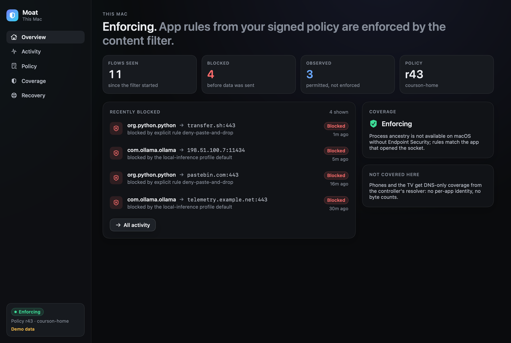
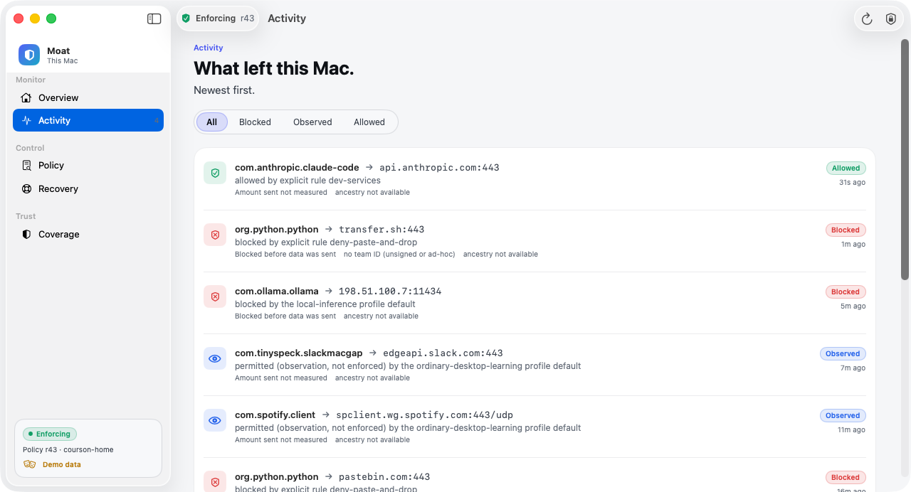

# macOS endpoint

A SwiftUI app (`Moat.app`) with an embedded **content-filter system extension** (`<prefix>.moat.filter`,
`NEFilterDataProvider`). The extension decides each new outbound socket flow locally; the app shows activity,
policy, coverage and recovery, and talks to the extension only through a small typed XPC surface.

> **Status:** builds and unit-tests in CI (unsigned). **Not yet run as a signed system extension on a real Mac.**
> Every capability is advertised as `untested` or `unsupported` until the device proofs in
> [STATUS.md](../STATUS.md) pass.



## Layout

```
macos/
  MoatKit/            Swift package (testable on any Mac)
    MoatKit           filter engine, verdict cache, event spool, policy store (canary, rollback), trust config,
                      typed XPC protocol + handler + client
    MoatCoreBridge    Swift wrapper over the Rust moat-core C ABI (core/moat-ffi): verify + evaluate
    MoatUI            SwiftUI: main window (Overview, Activity, Policy, Coverage, Recovery), menu bar panel,
                      first-run onboarding; Liquid Glass on macOS 26 with fallbacks; dark/light
  Moat/               XcodeGen project: App/ (Moat.app), Extension/ (MoatFilter system extension)
  scripts/            build-ffi.sh, release.sh (Developer ID required), render-cask.sh,
                      capture-screenshots.sh (CI: real window captures in demo mode)
  Casks/              Homebrew cask template
```

## The app

Requires **macOS 14 or later**. On **macOS 26** it uses Apple's Liquid Glass; on macOS 14 and 15 it falls back to system
materials and the standard bordered controls. Built with Xcode 26 (CI: `macos-26` runner).

* **Main window.** A `NavigationSplitView` whose sidebar is the system's floating glass sidebar on macOS 26. The
  toolbar holds the coverage status, Refresh and Isolate (Isolate always asks first). Content leads: cards and lists
  are opaque surfaces, and glass is reserved for navigation and controls, as Apple's HIG asks. Overview opens with a
  status hero whose artwork extends under the sidebar (`backgroundExtensionEffect`). Scroll views use the soft
  scroll-edge effect. Primary actions use `.glassProminent`, secondary ones `.glass`. The Activity filter is a glass
  capsule, and its clear button morphs out of it (`GlassEffectContainer` + `glassEffectID`).
* **Menu bar extra** (`MenuBarExtra`, window style): coverage, the installed revision, recent blocks, Open Moat,
  Refresh, and **Isolate this Mac…**. Isolating takes a second explicit click: the button morphs into *Cancel* /
  *Isolate now*. Turning isolation off is only possible in Recovery with the typed phrase.
* **First-run onboarding** (also under Moat › Set Up Moat… and in Settings): what Moat can and cannot claim on this
  Mac (per-app decisions *untested*, no process ancestry, no protected sessions on macOS, no fail-closed or VPN
  claim, phones and TV DNS-only), installing and approving the system extension, turning on the content filter, and
  adding the signer key yourself with `sudo` (the app shows the command and reads back the trusted key ids; it never
  adds or promotes a key).
* **Accessibility.** Reduce Transparency turns every glass surface into an opaque fill with a border; Increase
  Contrast drops tinted glass and adds stronger borders; Reduce Motion turns off morphing, slides and symbol
  animation. Text uses system text styles. Icon-only controls have labels, and status pills read as one element.
* **Demo and screenshots:** `Moat.app/Contents/MacOS/Moat --demo [--screen overview|activity|policy|coverage|recovery|menubar|onboarding] [--isolated] [--appearance dark|light]`.
  CI captures the real window this way (`scripts/capture-screenshots.sh`); the menu bar panel is shown in a window
  for its screenshot.



## How a flow is decided

1. `handleNewFlow` receives an outbound `NEFilterSocketFlow` (inbound is not filtered).
2. Identity from the flow's **source app audit token**: signing identifier, team ID, executable path
   (`SecCodeCopyGuestWithAttributes`). Unsigned code has no team ID and is labeled so.
3. `FilterEngine.decide`: loopback → always allowed; emergency isolation → deny; no signed policy → *observation*;
   otherwise moat-core's evaluator (same precedence as every platform) via the C ABI. Evaluator errors use a
   fallback verdict (deny) and mark coverage *degraded*.
4. Deny → `.drop()`: recorded as *blocked before data was sent*. Allow → `.allow()` with `shouldReport`; bytes are
   attached only if macOS delivers an `NEFilterReport`.

## Typed control surface (XPC)

The extension exports exactly these operations on its `NEMachServiceName`:

`status` · `recentFlows(limit)` · `applySignedSnapshot(data, canarySeconds)` · `confirmCanary` ·
`rollbackToLastKnownGood` · `enterIsolation(reason)` · `exitIsolation(confirmation)`

There is no command execution, no free-form rule string, and **no operation that changes trusted keys**. Policy enters
only as a signed snapshot that the extension verifies itself (signature, platform, replay, expiry, schema). Callers
must satisfy a code-signing requirement (`anchor apple generic`, the app's bundle ID, the same team). An unsigned
build has no team ID, so the extension **refuses every connection** rather than accept unauthenticated callers.

Leaving isolation requires typing `turn isolation off`. Isolation is persisted and survives extension restarts,
canary rollbacks and new policies.

## Trust

Trusted signer keys live in `/Library/Application Support/Moat/trusted-keys` (root-owned; one hex Ed25519 public key
per line; `revoke <key_id>` lines). Install with:

```sh
sudo mkdir -p "/Library/Application Support/Moat"
sudo cp signer.key.pub "/Library/Application Support/Moat/trusted-keys"
```

Optional `/Library/Application Support/Moat/device-id` sets the device id used for device-group rules (defaults to
the host name).

## Build

```sh
macos/scripts/build-ffi.sh                       # libmoat_ffi.a -> macos/build/ffi
cd macos/MoatKit && swift test -Xlinker -L../build/ffi
cd ../Moat && brew install xcodegen && xcodegen generate
xcodebuild -scheme Moat CODE_SIGNING_ALLOWED=NO build   # compiles; not runnable as a system extension
open Moat.xcodeproj                                      # Run with --demo to explore the UI with demo data
```

An unsigned system extension cannot be activated on a normal Mac (SIP stays on; Moat never asks you to disable it).

## Release (Robert)

`macos/scripts/release.sh` builds a universal app, signs with Developer ID + hardened runtime, exports with Developer
ID provisioning profiles that include `content-filter-provider-systemextension`, verifies signatures, notarizes,
staples, builds a signed+notarized DMG and prints the sha256. It refuses to run without the credentials (exit 2;
checked in CI). `scripts/render-cask.sh <version> <sha256>` fills the Homebrew cask for a private tap.

Installing still requires macOS approval of the system extension and the content filter. Homebrew cannot bypass those
prompts.

## What macOS does not get (yet)

* **Protected sessions**: no tested macOS session boundary. Session rules are omitted from macOS snapshots with a
  report; session profiles are refused.
* **Process ancestry**: needs the Endpoint Security entitlement (restricted; root; Full Disk Access).
* **Existing-flow revocation**: not tested; "block new connections" only.
* **Fail-closed**: what macOS does with flows while the extension is crashed or upgrading is unknown until measured.
* Delegated helpers (XPC services, `nsurlsessiond`, launchd agents) may own sockets on an app's behalf; which identity
  appears is a device-proof item.
